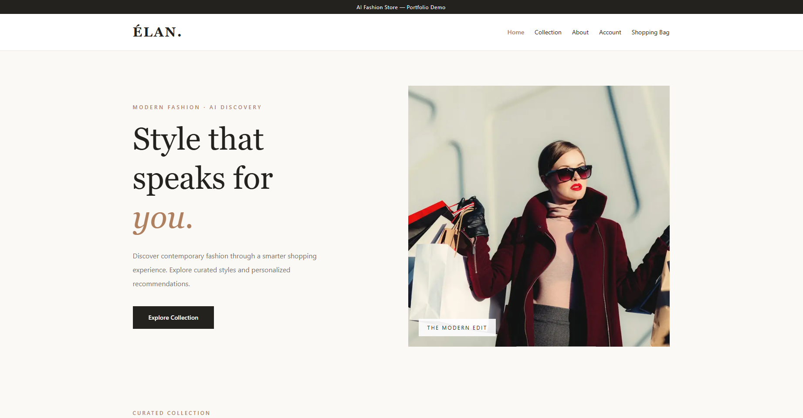
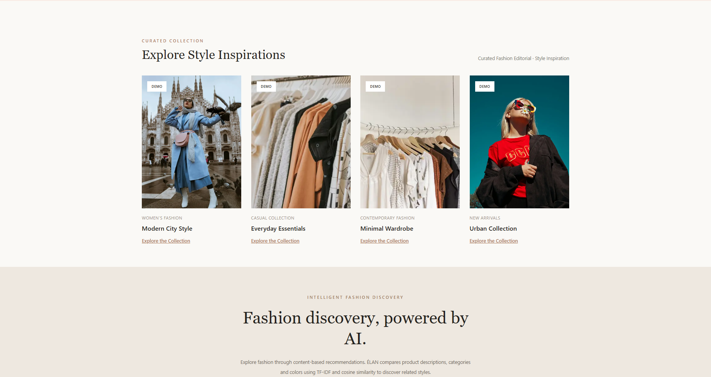
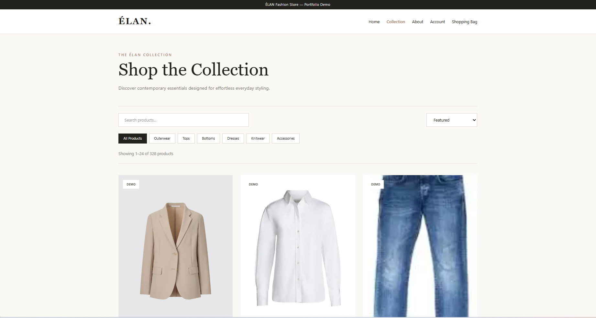
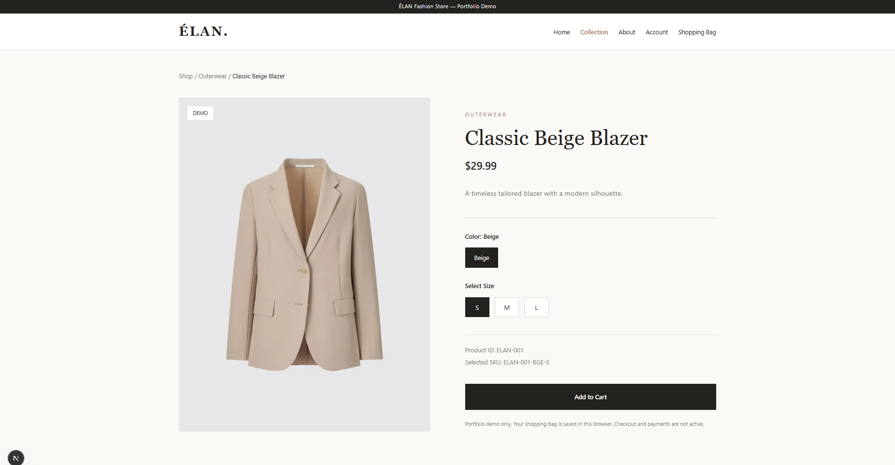
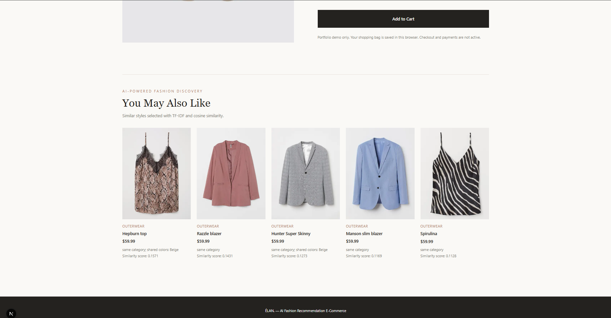

# ÉLAN - AI Fashion Recommender

**A full-stack fashion storefront with content-based recommendations, reproducible model evaluation, and a public live demo.**

[**Live Website**](https://elan-fashion-store.vercel.app/) | [**Backend Health**](https://elan-fashion-api.onrender.com/health) | [**Source Repository**](https://github.com/vankhiem1609/ai-fashion-recommender)

ÉLAN combines a Next.js storefront, a FastAPI product service, a SQLite product catalog, and a TF-IDF recommendation engine. The central engineering goal is to build and evaluate a transparent, maintainable similar-product recommendation system, not to present unvalidated improvements as production-ready.

> **Status: Public portfolio demo deployed.** The **V1 TF-IDF + cosine similarity** engine powers recommendations on the live website. V2, V3, and V4 are preserved as **offline experiments**, not deployed models. This is a demonstration storefront: there is **no real checkout, payment processing, or order fulfillment**.

## Website Screenshots

### Homepage



| Style Inspirations | Product Collection |
|:--:|:--:|
|  |  |

| Product Details | AI-Powered Recommendations |
|:--:|:--:|
|  |  |

**Try it:** [Open the ÉLAN Live Demo](https://elan-fashion-store.vercel.app/).

## Features

- **Storefront:** keyword search, category filtering, price sorting, and pagination (24 products per page).
- **Product pages:** descriptions, images, color/size variants, SKU selection, and product pricing.
- **Content-based discovery:** **You May Also Like** suggests the Top-5 most similar active products, with similarity scores and short explanations.
- **Shopping bag:** interactive portfolio-demo cart; no real purchases or payments.
- **Catalog administration:** admin-key-protected endpoints and interface for catalog maintenance. Administrative access is **not enabled** on the public demo.
- **Offline experimentation:** V1-V4 model comparisons using frozen rankings and relevance labels.
- **Reproducible evaluation:** scripts and committed reports for Precision@5, Strict Precision@5, and pooled-candidate nDCG@5.

### Demo Catalog

| Measure | Verified value |
|---|---:|
| Active products | **328** |
| Product variants (SKUs) | **343** |
| Product image assets in Git | **335** |
| Variants with image URLs | **341 / 343** |
| Top-K recommendations | **5** |

The demo catalog includes **320 sampled H&M articles and 8 original ÉLAN demo products**. Product prices are illustrative, not current retail prices. The counts above describe the verified release snapshot and repository assets; image-file count and product count are not expected to match one-to-one.

## Tech Stack

| Layer | Technology |
|---|---|
| Frontend | Next.js 16, React 19, TypeScript, Tailwind CSS 4 |
| Backend | Python, FastAPI, SQLModel, SQLAlchemy, Uvicorn |
| Database | SQLite (versioned release snapshot for the public demo) |
| Recommendation | scikit-learn, TF-IDF, cosine similarity; heuristic rerankers for offline experiments |
| Evaluation | Python, CSV/JSON reports, Precision@5, Strict Precision@5, nDCG@5 |
| Deployment | Vercel (frontend), Render (backend) |
| Development | Windows PowerShell, VS Code, Git, GitHub |

## System Architecture

```text
Browser (Public HTTPS)
        |
        v
Vercel - Next.js frontend
        |-- Storefront, collection, product details, shopping bag
        |-- /api/products and /api/recommendations/[productId]
        |
        |  Server-side API proxy (ELAN_BACKEND_URL)
        v
Render - FastAPI backend
        |-- GET /health
        |-- GET /products
        |-- GET /products/{slug}
        |-- GET /recommendations/{product_id}
        |
        +-- SQLModel / SQLite (elan_release.db)
        +-- V1 TF-IDF + cosine similarity recommendation engine
```

**Active recommendation path:** `frontend/src/components/YouMayAlsoLike.tsx` -> Next.js proxy -> `GET /recommendations/{product_id}` -> `backend/app/recommender.py` (V1).

The application recommends **similar products from catalog content**. It does **not** implement collaborative filtering, behavioral personalization, or user-profile training.

## Recommendation Models

| Version | Method | Application status |
|---|---|---|
| **V1** | Weighted text from category, product name, description, and colors -> TF-IDF (unigrams/bigrams) -> cosine similarity | **Active production baseline** |
| V2 | V1 similarity plus category and name-derived subtype reranking | Offline experiment |
| V3 | Refined subtype recognition and type-relation heuristics | Offline experiment |
| V4 | Reranking with H&M `product_type_name` metadata | Offline experiment |

V1 ranks active products and excludes the selected reference product from its results. V2-V4 were evaluated offline and are **not** connected to the public API.

## Offline Model Evaluation

The saved blind-review holdout includes **18 reference products** (3 per category), **140 unique reference-candidate pairs**, and **90 Top-5 positions per model**.

| Model | Precision@5 | Strict Precision@5 | nDCG@5* |
|---|---:|---:|---:|
| **V1 - Active baseline** | 66.7% | **24.4%** | **0.784** |
| V2 | 70.0% | 22.2% | 0.741 |
| V3 | 70.0% | 22.2% | 0.741 |
| V4 | **71.1%** | **24.4%** | 0.759 |

**Label scheme:** `0` = irrelevant; `1` = related; `2` = close substitute. Precision@5 counts labels >= 1; Strict Precision@5 counts only label 2.

* **nDCG@5** uses gain `2^relevance - 1` and an ideal ranking from **pooled retrieved candidates**, not the full catalog. The displayed nDCG@5 mean covers **16** references with defined ideal DCG; two references without relevant pooled candidates are excluded.
* Labels were assigned by an **AI evaluator** from product images and names without model-ranking identities. They were **not independently validated by human annotators**. These results are exploratory, not a confirmed measure of consumer recommendation quality.
* V4 improves Precision@5 over V1 by **4.4 percentage points** (4 of 90 positions), but trails V1 on nDCG@5 and ties it on Strict Precision@5. Its Tops-category Precision@5 decreases from **73.3%** to **53.3%**.
* A paired reference-bootstrap 95% percentile interval for V4 minus V1 Precision@5 is approximately **-7.8 to +15.6 percentage points**. The small holdout does not establish a robust improvement.

### Why V1 Is Deployed

**V1 remains the production engine** because it achieved the highest measured pooled-candidate nDCG@5, tied the highest strict precision, and already had a stable API integration. V4's modest gain on broad precision, category-level regression, uncertainty, and reliance on separately held metadata did not justify replacing V1.

The objective is **evidence-based model selection**, not maximizing one isolated benchmark number.

### Evaluation Evidence

- [Detailed evaluation report](backend/evaluation/holdout_v4_evaluation_report.md)
- [Structured metrics](backend/evaluation/holdout_v4_metrics.json)
- [Blind relevance labels](backend/evaluation/holdout_v4_blind_labeled.csv)
- [Frozen candidate rankings](backend/evaluation/holdout_v4_candidate_union.csv)
- [Evaluation script](backend/evaluation/evaluate_holdout_v4_results.py)

### Reproduce the Saved Evaluation (Windows PowerShell)

Run from the repository root after creating the backend virtual environment and installing its requirements:

```powershell
.\backend\.venv\Scripts\python.exe .\backend\evaluation\evaluate_holdout_v4_results.py --out-dir .\backend\evaluation\recomputed
```

This script recalculates metrics from committed CSV inputs, without executing recommendation models or accessing SQLite. It writes to a separate output directory; use a new directory on subsequent runs, or explicitly pass `--overwrite` if appropriate.

## Run Locally (Windows PowerShell)

**Prerequisites:** Python compatible with `backend/requirements.txt`, Node.js/npm compatible with Next.js 16, and Git.

### 1. Backend (Terminal 1)

```powershell
git clone https://github.com/vankhiem1609/ai-fashion-recommender.git
cd ai-fashion-recommender\backend

py -m venv .venv
.\.venv\Scripts\Activate.ps1
python -m pip install -r requirements.txt

# Use the committed release snapshot; do not overwrite the local catalog.
$env:ELAN_CATALOG_MODE = "release"
python -m uvicorn app.main:app --reload --host 127.0.0.1 --port 8001
```

Check `http://127.0.0.1:8001/health`. The `release` mode reads `backend/data/elan_release.db`. The default `local` mode uses `backend/data/elan.db`, which is intentionally **not** committed.

For **local-only admin operations**, explicitly configure your own secret as `ELAN_ADMIN_KEY` and use a suitable local catalog. The deployed public demo does not expose enabled administrative access.

### 2. Frontend (Terminal 2)

From the repository root in another PowerShell terminal:

```powershell
cd frontend
npm ci
$env:ELAN_BACKEND_URL = "http://127.0.0.1:8001"
npm run dev
```

Open `http://localhost:3000` or `http://localhost:3000/shop`.

## Deployment

| Component | Hosting | Configuration |
|---|---|---|
| Frontend | Vercel | Root directory: `frontend`; Next.js framework |
| Backend | Render Web Service | Root directory: `backend`; Python / Uvicorn |
| Production catalog | SQLite snapshot shipped with backend | `ELAN_CATALOG_MODE=release` |
| Frontend-to-backend routing | Server-side Next.js API proxy | `ELAN_BACKEND_URL=https://elan-fashion-api.onrender.com` |

**Render build:** `pip install -r requirements.txt`

**Render start:** `uvicorn app.main:app --host 0.0.0.0 --port $PORT`

**Render health-check path:** `/health`

**Hosting limitation:** The Render Free instance may spin down after inactivity, producing a slow first request. Its local filesystem is ephemeral. The committed SQLite snapshot makes the read-oriented catalog available on startup; production data writes should not be treated as durable storage.

## Data and Image Assets

- The release catalog is the versioned snapshot `backend/data/elan_release.db` (328 products, 343 variants); the working `backend/data/elan.db` remains excluded from Git.
- Product images used by the storefront are under `frontend/public/products/` (**335 tracked `.jpg` / `.webp` assets**).
- The sample references metadata from the *H&M Personalized Fashion Recommendations* dataset. The full source dataset and private local source CSV files are not included.
- Demo pricing is illustrative; this portfolio site does not perform live retail pricing, orders, or payments.
- Anyone publishing or redistributing catalog data or product imagery should verify applicable dataset and image usage rights before making the repository public.
- The two variants without an image URL are preserved; missing local image-file paths were not found among image URLs in the verified release catalog.

## Project Structure

```text
ai-fashion-recommender/
|-- backend/
|   |-- app/
|   |   |-- main.py              # FastAPI application
|   |   |-- database.py          # local / public_demo / release modes
|   |   |-- models.py            # Product and variant schemas
|   |   |-- recommendations.py   # Public V1 API route
|   |   |-- recommender.py       # Active TF-IDF baseline
|   |   |-- recommender_v2.py    # Offline experiment
|   |   |-- recommender_v3.py    # Offline experiment
|   |   `-- recommender_v4.py    # Offline experiment
|   |-- data/
|   |   `-- elan_release.db      # Versioned public demo snapshot
|   |-- evaluation/              # Frozen labels, metrics, scripts
|   `-- requirements.txt
|-- frontend/
|   |-- public/products/         # Product image assets
|   |-- src/app/shop/            # Storefront and product pages
|   |-- src/app/api/             # Backend proxy endpoints
|   `-- src/components/YouMayAlsoLike.tsx
|-- docs/screenshots/
|   |-- home.png
|   |-- style-inspirations.png
|   |-- collection.png
|   |-- product-details.png
|   `-- recommendations.png
`-- README.md
```

## Limitations and Future Work

- Expand the evaluation set and obtain **independent human relevance judgments**.
- Improve catalog taxonomy, subtype consistency, and coverage for uncommon product types.
- Add automated regression and end-to-end tests for public deployments.
- Consider a persistent production database if durable catalog editing becomes a requirement.
- Investigate embeddings or hybrid retrieval only when broader evaluation supports a measurable gain.

---

**Portfolio emphasis:** full-stack AI integration, transparent content-based retrieval, reproducible offline evaluation, careful production model selection, and cost-conscious deployment.
